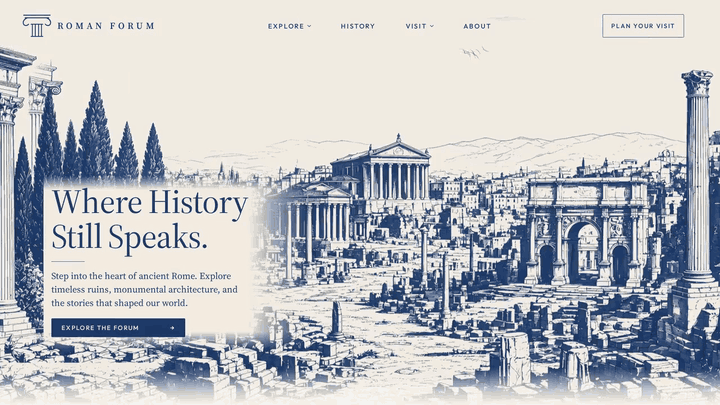

# Roman Forum

[](https://victoriawu-77.github.io/roman-forum/)

[Watch the full walkthrough with sound](media/roman-forum-demo.mp4)

Live: [victoriawu-77.github.io/roman-forum](https://victoriawu-77.github.io/roman-forum/)

A single-page landing in blue steel-pen. The Forum fills the first screen; the sanctuary of Apollo at Delphi waits at the foot of the page. Ink `#1B3A6B` on paper `#F3EDE2`, drawn edge to edge, with the navigation and headline laid as real HTML over the plate.

## What you can do

- Move through the Forum drawing: nearer layers travel further with the pointer (and with tilt on a phone).
- Gulls cross the Forum sky; birds of prey circle over Delphi. Get close and they scatter.
- Open four landmark viewers — the Forum floor, Temple of Saturn, Arch of Septimius Severus, Basilica Julia — then walk into the Arch.
- On load, the ink drawing builds in; a flat plate covers the stack until every layer is ready.
- Prefer less motion? The layers hold still and the birds are drawn once.

## Open locally

```bash
python3 -m http.server 43123
```

Then open [http://127.0.0.1:43123](http://127.0.0.1:43123). A local server is the reliable way to load fonts and scripts; opening `index.html` as a file can block them.

## Notes for builders

Each drawing is cut into four depth layers (`assets/layers/*.webp`), stacked so that at rest they rebuild the original plate. A flat copy sits on top and fades out only once every layer has decoded. Layers carry a mirrored margin so travel never shows an edge. On phones, the first tap may ask for motion access (required on iOS); if motion is refused, a sideways drag on the Forum moves the layers instead.

Every stylesheet, script, font, and image is linked with a version query. Raise it on each release so browsers fetch the new files.

Source Serif 4 and Outfit are included under the SIL Open Font License — see `assets/fonts/OFL.txt`.
